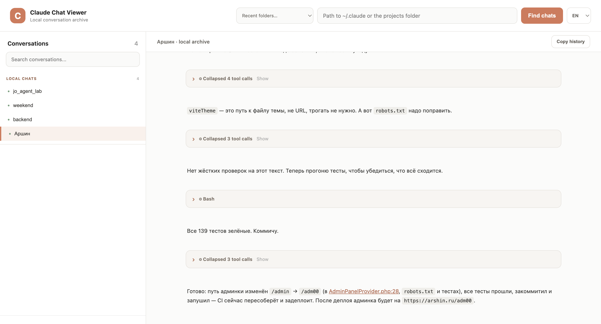

# Claude Chat Viewer

A local web app for browsing, organizing, and preserving **Claude Code** conversation history.

Claude Chat Viewer reads Claude Code's local JSONL session files, lets you browse conversations across different Claude data directories, and save selected conversations into a separate local archive. It runs on your machine with Python and Flask — no Docker, cloud service, or external API required.

> **Project status:** This is a local, community-oriented viewer. It is not an official Anthropic product and is not affiliated with Anthropic.

## Features

- **Browse Claude Code history** — scan a `~/.claude` directory or a `projects` directory and discover JSONL conversation files.
- **Work with multiple Claude data directories** — switch between local folders used by different Claude Code profiles or accounts. The app remembers up to 12 recently scanned paths in your browser.
- **Keep a curated local archive** — save only the source conversations you consider important. Saved conversations appear in a persistent **Local chats** section and remain available even when no source folder has been scanned.
- **Append conversations by project** — the first saved conversation creates a local project conversation. Saving other source conversations for the same project appends their messages to that local conversation. Saving again imports only messages that have not already been imported.
- **Sort source conversations by recent activity** — the newest conversations appear first within each project.
- **Render Markdown** — view formatted text, headings, lists, tables, and code blocks.
- **Inspect tool activity** — tool calls and their results are represented as expandable entries. Consecutive tool calls are grouped into a collapsible block.
- **Delete messages from the local archive** — remove individual messages or tool entries from a saved local conversation. Deletions are retained when source chats are imported again.
- **Copy a readable transcript** — copy visible text messages with author, date, and message text. Tool calls and tool results are excluded.
- **Switch the interface language** — Russian and English are available. The selected language is remembered in the browser.
- **Keep data local** — source JSONL files are read but not modified. The app writes its own archive to the project's `history/` directory.

## Screenshots

_Add screenshots here, for example:_

```text
docs/
  screenshots/
    overview.png
    conversation.png
```

Then embed them in this section:

```markdown

```

## Requirements

- Python 3.9 or newer
- A local Claude Code installation with conversation history
- A modern desktop browser

The app uses:

- Flask
- Python-Markdown
- Bleach

## Installation

Clone the repository:

```bash
git clone git@github.com:artypro/claude_chat_viewer.git
cd claude_chat_viewer
```

Create and activate a virtual environment.

### macOS / Linux

```bash
python3 -m venv .venv
source .venv/bin/activate
```

### Windows PowerShell

```powershell
py -m venv .venv
.venv\Scripts\Activate.ps1
```

Install dependencies:

```bash
python -m pip install --upgrade pip
pip install -r requirements.txt
```

## Run

Start the local server:

```bash
python app.py
```

Open:

[http://127.0.0.1:5055](http://127.0.0.1:5055)

The server binds to `127.0.0.1` by default, so it is intended for access from the same computer.

## Find Claude Code conversations

1. Locate the Claude data directory for the profile/account you want to browse.
2. Enter the path in the folder field.
3. You can provide either the `.claude` directory or its `projects` subdirectory.
4. Click **Find chats**.

Typical locations:

| Platform | Common location |
|---|---|
| macOS / Linux | `~/.claude` |
| Windows | `%USERPROFILE%\.claude` |

The app searches for `*.jsonl` files under the `projects` directory.

### Using multiple Claude accounts or profiles

If you use separate Claude Code profiles/accounts with separate local data directories:

1. Scan the first profile's `.claude` directory.
2. Browse its conversations and save the ones you want to keep.
3. Enter the second profile's `.claude` directory and scan it.
4. Repeat for any other local profiles.

The recent-path selector makes it easier to switch between directories. A scan replaces the currently displayed **source conversations** with results from the selected directory; it does not remove your saved local archive.

**Important:** the local archive is organized by project name, not by Claude account. If two profiles contain projects with the same project name, their selected conversations may be appended to the same local project conversation. Keep this in mind when curating chats from multiple profiles.

This app does not sign in to Claude accounts, manage account credentials, or access Anthropic's cloud conversation history. It only reads local Claude Code data directories that you point it to.

## Save and organize local conversations

Each source conversation has a **Save chat** action.

- The first saved conversation for a project creates a local conversation for that project.
- Saving another source conversation from the same project appends its messages to the existing local conversation.
- Re-saving a source conversation imports only newly discovered messages; already imported messages are not duplicated.
- Local conversations are listed separately and can be opened without scanning a source directory.
- Local archive data is stored in JSONL files under `history/`, next to `app.py`.

The source files under Claude's `.claude/projects` directory are never edited by the viewer.

### Deleting messages

Messages and tool entries can be deleted from a local conversation. Deletion information is stored in the local archive so that deleted content is not reintroduced when the corresponding source conversation is saved again.

Deleting an entry from the local archive does not delete it from Claude Code's original JSONL file.

## Copying a conversation

Use **Copy history** to copy the readable transcript to the clipboard. The copied text includes:

- Author
- Timestamp
- Message text

Tool calls and tool results are not included.

## Data storage and privacy

- The app reads local Claude Code JSONL files.
- The app stores its own curated archive in `history/*.jsonl`.
- Recent source folder paths and the selected UI language are stored in the browser's `localStorage`.
- No external API calls are required for normal operation.
- The default server address is `127.0.0.1`, not `0.0.0.0`.

**Back up your `history/` directory.** It contains the conversations you explicitly saved in the viewer. Do not commit private conversation data, local paths, credentials, or personal information to a public repository.

## Project structure

```text
.
├── app.py
├── requirements.txt
├── README.md
├── history/              # Created automatically for saved local conversations
├── templates/
│   └── index.html
└── static/
    ├── app.js
    └── style.css
```

## Troubleshooting

### No conversations are found

- Make sure the path exists and is accessible.
- Try the `.claude` directory itself or its `projects` subdirectory.
- Confirm that Claude Code has created JSONL session files under `projects/`.

### I switched folders but still see local conversations

This is expected. Scanning a different source directory changes the source conversation list, while saved local conversations remain available in the **Local chats** section.

### The page does not reflect updated JavaScript or CSS

Perform a hard refresh:

- Windows / Linux: `Ctrl + F5`
- macOS: `Cmd + Shift + R`

### The server cannot start

Make sure the virtual environment is active and dependencies are installed:

```bash
pip install -r requirements.txt
python app.py
```

## Contributing

Issues, bug reports, documentation improvements, and pull requests are welcome.

When reporting a bug, include:

- Operating system
- Python version
- Steps to reproduce
- Relevant terminal output or browser console errors

Do not attach private Claude conversation files unless you have removed sensitive information and explicitly intend to share them.

## License

MIT
